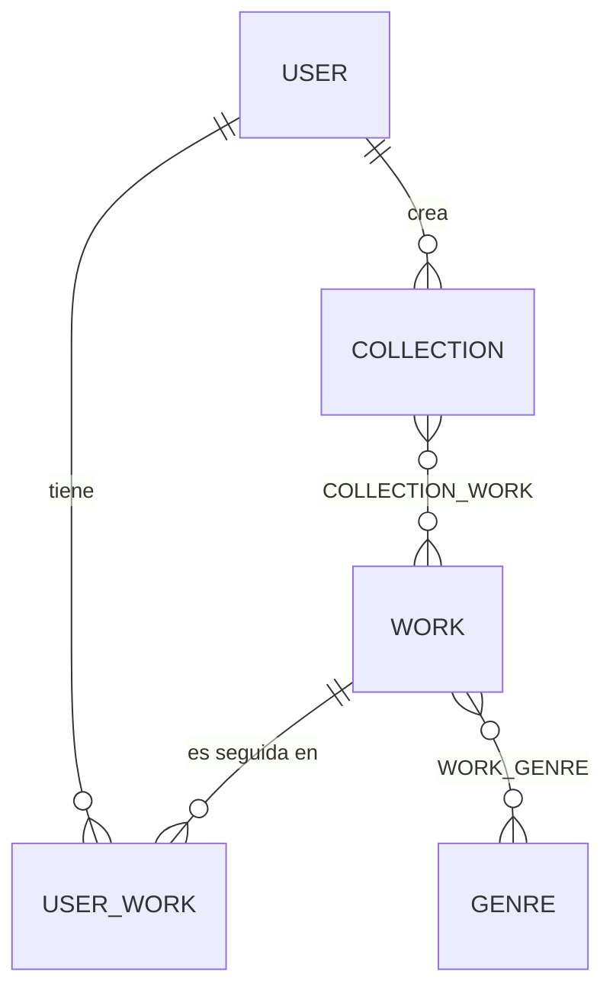

# Visión SQL – MangaVault

> [!NOTE]
> **Estado: ✅ Implementado (MVP 3)** con `Microsoft.Data.Sqlite 10.0.0` (SQL directo parametrizado, `COLLATE NOCASE` en `Works.Title` y `Collections.Name`, seed de 20 géneros e importador idempotente `JsonToSqliteImporter`).

Reemplazar los JSON (`users.json`, `mangas.json`, `favorites.json`) por una base relacional.

## Motor recomendado: **SQLite**
- Un solo archivo (`mangavault.db`), cero instalación → ideal para ejecutar sin IDE.
- Acceso con **EF Core** (`Microsoft.EntityFrameworkCore.Sqlite`) o **Dapper** (más simple, encaja con los repositorios actuales).
- Alternativa si se quiere servidor: SQL Server LocalDB (el DDL es casi igual).

Ubicación: `%LOCALAPPDATA%\MangaVault\mangavault.db` (no en la carpeta del proyecto ni en `bin/`).

## Modelo de datos



## DDL (SQLite)
```sql
PRAGMA foreign_keys = ON;

CREATE TABLE Users (
    UserId       INTEGER PRIMARY KEY AUTOINCREMENT,
    Name         TEXT NOT NULL UNIQUE COLLATE NOCASE,
    PasswordHash TEXT NOT NULL,
    Role         INTEGER NOT NULL DEFAULT 0,       -- 0 User, 1 Mangaka, 2 Admin
    CreatedAt    TEXT NOT NULL DEFAULT (datetime('now'))
);

CREATE TABLE Works (
    WorkId        INTEGER PRIMARY KEY AUTOINCREMENT,
    Type          INTEGER NOT NULL DEFAULT 0,      -- 0 Manga, 1 LightNovel
    Title         TEXT NOT NULL,
    Author        TEXT NOT NULL DEFAULT '',        -- mangaka / escritor
    Illustrator   TEXT,                            -- útil en LN
    VolumeCount   INTEGER NOT NULL DEFAULT 0 CHECK (VolumeCount >= 0),
    FinalChapters INTEGER NOT NULL DEFAULT 0 CHECK (FinalChapters >= 0),
    Status        INTEGER NOT NULL DEFAULT 0,      -- 0 Ongoing,1 Completed,2 Hiatus,3 Cancelled
    CoverPath     TEXT,
    Synopsis      TEXT,
    UNIQUE (Title, Type)
);

CREATE TABLE Genres (
    GenreId     INTEGER PRIMARY KEY AUTOINCREMENT,
    Name        TEXT NOT NULL UNIQUE COLLATE NOCASE,
    Description TEXT NOT NULL DEFAULT ''
);

CREATE TABLE WorkGenres (
    WorkId  INTEGER NOT NULL REFERENCES Works(WorkId)  ON DELETE CASCADE,
    GenreId INTEGER NOT NULL REFERENCES Genres(GenreId) ON DELETE CASCADE,
    PRIMARY KEY (WorkId, GenreId)
);

-- Antes "MangaEntry": progreso del usuario
CREATE TABLE UserWorks (
    UserId         INTEGER NOT NULL REFERENCES Users(UserId) ON DELETE CASCADE,
    WorkId         INTEGER NOT NULL REFERENCES Works(WorkId) ON DELETE CASCADE,
    ReadingStatus  INTEGER NOT NULL DEFAULT 2,     -- 1 Reading..5 Dropped
    CurrentChapter INTEGER NOT NULL DEFAULT 0 CHECK (CurrentChapter >= 0),
    OwnedVolumes   INTEGER NOT NULL DEFAULT 0,
    Rating         INTEGER CHECK (Rating BETWEEN 1 AND 10),
    IsFavorite     INTEGER NOT NULL DEFAULT 0,
    DateAdded      TEXT NOT NULL DEFAULT (datetime('now')),
    PRIMARY KEY (UserId, WorkId)
);

CREATE TABLE Collections (
    CollectionId INTEGER PRIMARY KEY AUTOINCREMENT,
    UserId       INTEGER NOT NULL REFERENCES Users(UserId) ON DELETE CASCADE,
    Name         TEXT NOT NULL,
    UNIQUE (UserId, Name)
);

CREATE TABLE CollectionWorks (
    CollectionId INTEGER NOT NULL REFERENCES Collections(CollectionId) ON DELETE CASCADE,
    WorkId       INTEGER NOT NULL REFERENCES Works(WorkId) ON DELETE CASCADE,
    PRIMARY KEY (CollectionId, WorkId)
);

CREATE INDEX IX_Works_Title      ON Works(Title);
CREATE INDEX IX_UserWorks_Status ON UserWorks(UserId, ReadingStatus);
```

Notas de diseño:
- **Favoritos** = columna `IsFavorite` en `UserWorks` (elimina la necesidad de `JsonFavoriteRepository`/`DuplicateFavoriteException`; el PK ya evita duplicados).
- Ids autogenerados por la BD (hoy el código nunca los asigna).
- Enums guardados como `INTEGER`; mantener los valores numéricos estables.

## Migración desde JSON
1. Crear BD con el DDL al primer arranque (`CREATE TABLE IF NOT EXISTS` o migraciones EF).
2. Script/botón "Importar JSON" una sola vez (los JSON actuales están vacíos, así que es opcional).
3. Mantener las interfaces `IUserRepository`, `IMangaRepository` → solo cambia la implementación (`SqliteUserRepository`...). Esa es la ventaja de la arquitectura actual.

## Buenas prácticas
- Consultas **parametrizadas** siempre (nunca concatenar strings).
- Transacción al guardar obra + géneros.
- Backup: copiar el `.db` (exportar desde Ajustes).
- Hash de contraseña con salt (PBKDF2 `Rfc2898DeriveBytes.Pbkdf2`), nunca texto plano.
